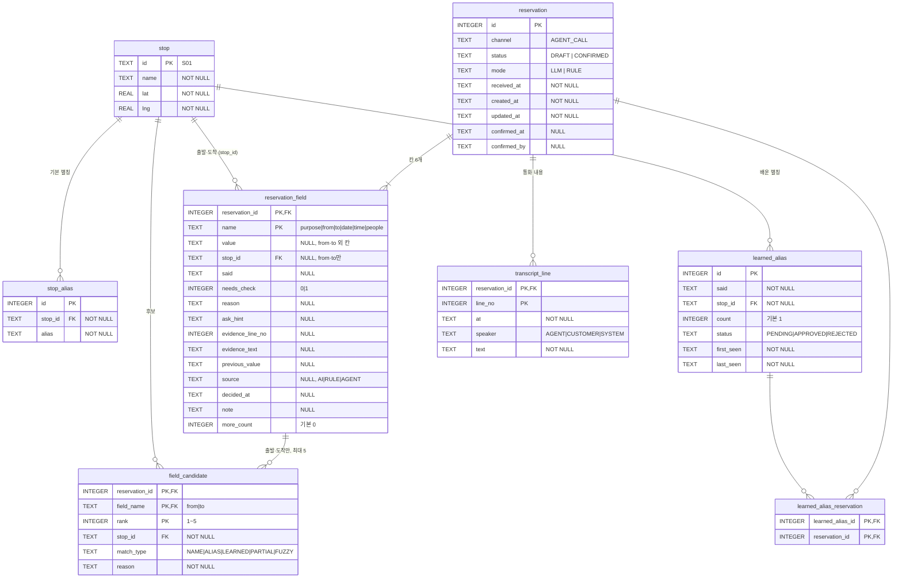

# ERD

> 작성 강대운(BE) · 2026-11-10 · 초안 · 기준: `docs/api.md`
> 저장소: **SQLite** (`data/malbus.db`, 서버 시작 시 `schema.sql` + `data/정류장.csv`로 생성. DB 파일은 저장소에 올리지 않음)
> 구현: Spring Boot + Spring Data JPA (`sqlite-jdbc`, Hibernate `SQLiteDialect`). 운영 때는 설정만 바꿔 MySQL로 옮길 수 있게 JPA 엔티티로 작성



## 테이블 요약

| 테이블 | 역할 | API 모델 |
|---|---|---|
| `stop` | 정류장 (CSV에서 적재, 읽기 전용) | `Stop` |
| `stop_alias` | 기본 별칭 (CSV `별칭` 칸을 `\|`로 나눈 행) | `Stop.aliases` |
| `reservation` | 예약 한 건 | `Reservation` |
| `reservation_field` | 예약의 칸 6개 (예약당 6행) | `Field`, `StopField` |
| `field_candidate` | 출발·도착 후보 (칸당 최대 5행) | `StopField.candidates` |
| `transcript_line` | 통화 한 줄 | `TranscriptLine` |
| `learned_alias` | 상담원이 추가한 별칭 | `LearnedAlias` |
| `learned_alias_reservation` | 별칭이 기록된 예약 (N:M) | `LearnedAlias.reservationIds` |

## 설계 메모

- **출발·도착 FK:** `reservation_field.stop_id`에만 정류장 FK를 건다. 목록 밖 ID는 DB가 거부한다. 다른 칸 값은 `value`(TEXT)에 저장하고 API에서 타입 변환(`people` → 숫자). `people`은 예약인데 인원을 말 안 하면 `value = '1'`, `said` NULL, `source = 'RULE'`로 저장 (변경·취소·문의는 NULL).
- **`conflicts`는 저장하지 않음:** `learned_alias`에서 같은 `said`·다른 `stop_id` 행을 조회해 계산한다.
- **DB로 못 막는 규칙은 BE가 검사:** 출발 ≠ 도착(행이 달라 CHECK 불가), 과거 날짜, 확정 조건, 확정 후 수정 금지.
- **D-6 JSON 화면:** `GET /reservations/{id}` 응답을 그대로 보여 준다. 파일로 따로 내보내지 않음.
- **연결마다** `PRAGMA foreign_keys = ON;` 필수 (SQLite는 기본이 꺼짐). Spring에서는 JDBC URL에 `?foreign_keys=on`을 붙여 모든 연결에 적용하고, 구현할 때 FK 위반이 실제로 막히는지 테스트로 확인.
- **ENUM·BOOLEAN·DATETIME 없음:** CHECK 제약, 0/1 정수, ISO 8601 TEXT로 대신.

## schema.sql

```sql
PRAGMA foreign_keys = ON;

CREATE TABLE stop (
  id   TEXT PRIMARY KEY,
  name TEXT NOT NULL,
  lat  REAL NOT NULL,
  lng  REAL NOT NULL
) STRICT;

CREATE TABLE stop_alias (
  id      INTEGER PRIMARY KEY,
  stop_id TEXT NOT NULL REFERENCES stop(id),
  alias   TEXT NOT NULL,
  UNIQUE (stop_id, alias)
) STRICT;

CREATE TABLE reservation (
  id           INTEGER PRIMARY KEY,
  channel      TEXT NOT NULL DEFAULT 'AGENT_CALL' CHECK (channel IN ('AGENT_CALL')),
  status       TEXT NOT NULL DEFAULT 'DRAFT' CHECK (status IN ('DRAFT','CONFIRMED')),
  mode         TEXT NOT NULL CHECK (mode IN ('LLM','RULE')),
  received_at  TEXT NOT NULL,
  created_at   TEXT NOT NULL,
  updated_at   TEXT NOT NULL,
  confirmed_at TEXT,
  confirmed_by TEXT,
  CHECK ((status = 'CONFIRMED') = (confirmed_at IS NOT NULL AND confirmed_by IS NOT NULL))
) STRICT;

CREATE TABLE reservation_field (
  reservation_id   INTEGER NOT NULL REFERENCES reservation(id) ON DELETE CASCADE,
  name             TEXT NOT NULL CHECK (name IN ('purpose','from','to','date','time','people')),
  value            TEXT,
  stop_id          TEXT REFERENCES stop(id),
  said             TEXT,
  needs_check      INTEGER NOT NULL DEFAULT 1 CHECK (needs_check IN (0,1)),
  reason           TEXT CHECK (reason IN ('MISSING','AMBIGUOUS','INVALID','CORRECTED','NOT_IN_LIST')),
  ask_hint         TEXT,
  evidence_line_no INTEGER,
  evidence_text    TEXT,
  previous_value   TEXT,
  source           TEXT CHECK (source IN ('AI','RULE','AGENT')),
  decided_at       TEXT,
  note             TEXT,
  more_count       INTEGER NOT NULL DEFAULT 0,
  PRIMARY KEY (reservation_id, name),
  CHECK (name IN ('from','to') OR stop_id IS NULL),   -- 정류장 FK는 출발·도착만
  CHECK (name NOT IN ('from','to') OR value IS NULL), -- 출발·도착 값은 stop_id에
  CHECK (needs_check = 1 OR reason IS NULL)           -- 확인 완료면 사유 없음
) STRICT;

CREATE TABLE field_candidate (
  reservation_id INTEGER NOT NULL,
  field_name     TEXT NOT NULL CHECK (field_name IN ('from','to')),
  rank           INTEGER NOT NULL CHECK (rank BETWEEN 1 AND 5),
  stop_id        TEXT NOT NULL REFERENCES stop(id),
  match_type     TEXT NOT NULL CHECK (match_type IN ('NAME','ALIAS','LEARNED','PARTIAL','FUZZY')),
  reason         TEXT NOT NULL,
  PRIMARY KEY (reservation_id, field_name, rank),
  UNIQUE (reservation_id, field_name, stop_id),
  FOREIGN KEY (reservation_id, field_name)
    REFERENCES reservation_field(reservation_id, name) ON DELETE CASCADE
) STRICT;

CREATE TABLE transcript_line (
  reservation_id INTEGER NOT NULL REFERENCES reservation(id) ON DELETE CASCADE,
  line_no        INTEGER NOT NULL CHECK (line_no >= 1),
  at             TEXT NOT NULL,
  speaker        TEXT NOT NULL CHECK (speaker IN ('AGENT','CUSTOMER','SYSTEM')),
  text           TEXT NOT NULL,
  PRIMARY KEY (reservation_id, line_no)
) STRICT;

CREATE TABLE learned_alias (
  id         INTEGER PRIMARY KEY,
  said       TEXT NOT NULL,
  stop_id    TEXT NOT NULL REFERENCES stop(id),
  count      INTEGER NOT NULL DEFAULT 1 CHECK (count >= 1),
  status     TEXT NOT NULL DEFAULT 'PENDING' CHECK (status IN ('PENDING','APPROVED','REJECTED')),
  first_seen TEXT NOT NULL,
  last_seen  TEXT NOT NULL,
  UNIQUE (said, stop_id)
) STRICT;

CREATE TABLE learned_alias_reservation (
  learned_alias_id INTEGER NOT NULL REFERENCES learned_alias(id) ON DELETE CASCADE,
  reservation_id   INTEGER NOT NULL REFERENCES reservation(id) ON DELETE CASCADE,
  PRIMARY KEY (learned_alias_id, reservation_id)
) STRICT;

CREATE INDEX idx_reservation_status ON reservation(status);
CREATE INDEX idx_learned_alias_said ON learned_alias(said);
CREATE INDEX idx_learned_alias_status ON learned_alias(status);
```

